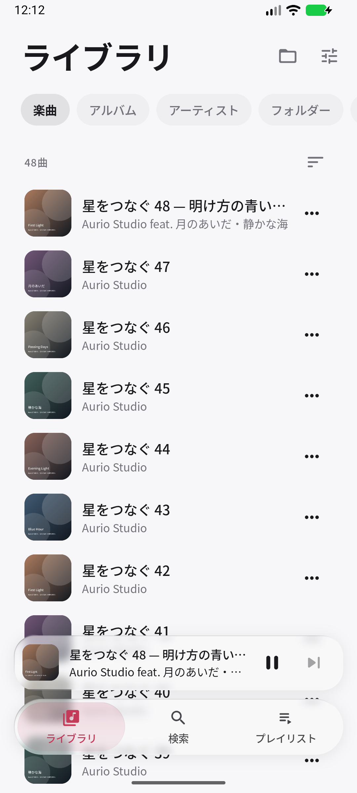
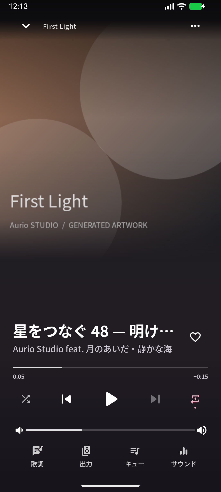

# Aurio

**好きな音楽を、自分のペースで。**

端末にある音楽を、美しく、軽やかに楽しむオフラインプレイヤー。

[APKをダウンロード](https://github.com/noppy3325-droid/luma-music/releases) · [使い始める](#使い始める) · [ビルド](#開発する)

Android 10+　 ·　 オフライン再生　 ·　 オープンソース

## 音楽に集中できる場所

| ライブラリ | 再生画面 |
|:---:|:---:|
|  |  |

*画面の楽曲名とアートワークはテスト用に生成したものです。*

- **自分の音楽を整理** — フォルダーを選ぶだけで、楽曲・アルバム・アーティストを閲覧。検索、お気に入り、プレイリストにも対応。
- **自然な操作** — ミニプレイヤーを左右にスワイプして曲送り、上に引いて再生画面へ。キューの確認や編集もできます。
- **自分好みのサウンド** — 10バンドEQ、プリセット、音量均一化、ステレオ幅を調整。加工をバイパスするDirectモードも選べます。
- **いつもの聴き方に対応** — 歌詞、シャッフル、リピート、バックグラウンド再生、通知操作、USBオーディオやBluetooth出力に対応。

## 使い始める

1. [リリースページ](https://github.com/noppy3325-droid/luma-music/releases)から最新のAPKをダウンロードし、Android端末にインストールします。
2. アプリを開き、音楽が入ったフォルダーを選びます。
3. ライブラリから曲を選んで再生します。右上の設定からフォルダーを追加できます。

既存版と同じ署名のAPKは上書きインストールできます。リリースは開発用の署名鍵で署名されています。

## 開発する

Kotlin、Jetpack Compose、Media3で構築しています。JDK 17以上、Android SDK Platform 37、Build Tools 36.0.0が必要です。SDKの場所は local.properties に設定してください。

    ./gradlew :core:test :app:testDebugUnitTest :app:assembleDebug :app:lintDebug

Windowsでは gradlew.bat を使ってください。assembleRelease は署名前のAPKを生成します。

音声処理と対応状況は[音声設計](docs/audio-dsp-v020.md)、依存関係とライセンスは[サードパーティ表記](THIRD_PARTY_NOTICES.md)をご覧ください。24bit/float音源は現在の共通再生経路でPCM16に変換されます。出力機器の仕様やビットパーフェクト再生は、確認できた情報だけを表示します。

## ライセンス

Aurioのソースコードは [MIT License](LICENSE) で公開しています。組み込まれたフォントやライブラリには、それぞれのライセンスが適用されます。
